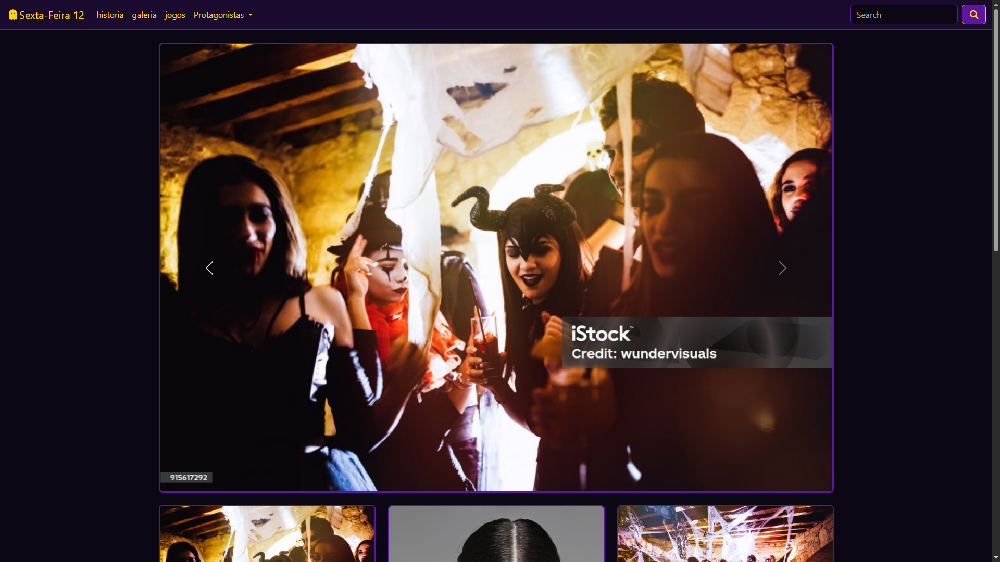
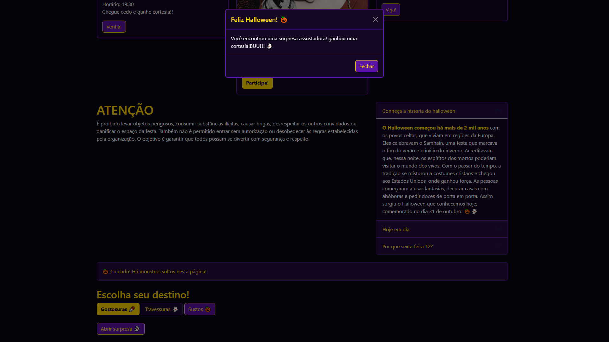

# 🎃 Halloween Invitation Project

Site de convite interativo para uma festa de Halloween, desenvolvido com HTML, CSS, Bootstrap e JavaScript.

O projeto apresenta uma página temática com elementos visuais inspirados no Halloween, proporcionando uma experiência interativa e divertida para os convidados.

---

## 🚀 Tecnologias

- HTML5
- CSS3
- Bootstrap
- JavaScript
- Font Awesome

---

## ⚙️ Funcionalidades

✔ Página temática de Halloween  
✔ Interface visual personalizada  
✔ Elementos interativos com JavaScript  
✔ Estilização utilizando CSS e Bootstrap  
✔ Ícones e elementos visuais com Font Awesome  
✔ Layout desenvolvido para apresentar um convite digital  

---

## 🎃 Sobre o projeto

O projeto consiste em um convite digital para uma festa de Halloween, desenvolvido com o objetivo de explorar a criação de páginas web temáticas e interativas.

A proposta é substituir os convites tradicionais por uma experiência digital, utilizando elementos visuais, cores e recursos interativos para transmitir a atmosfera do Halloween.

---

## 🛠️ Estrutura do projeto

- `index.html` — Estrutura principal da página.
- `css/` — Arquivos de estilização.
- `js/` — Scripts responsáveis pelas interações.
- `img/` — Imagens utilizadas no projeto.
- `fontawesome/` — Biblioteca de ícones.

---

## ▶️ Como executar

1. Clone o repositório:

```bash
git clone https://github.com/Biel9080/Halloween-invitation-project.git
```

2. Abra a pasta do projeto.

3. Execute o arquivo `index.html` em seu navegador.

---

## 🌐 Acesse o projeto

[Visualizar Halloween Invitation Project](https://biel9080.github.io/Halloween-invitation-project/)

---

## 📚 Aprendizados

Durante este projeto foram praticados:

- Estruturação de páginas com HTML5.
- Estilização e personalização com CSS3.
- Utilização do framework Bootstrap.
- Manipulação de elementos com JavaScript.
- Organização de arquivos e pastas em projetos web.
- Desenvolvimento de interfaces temáticas e interativas.

---

## 📸 Screenshots

### Tela inicial


### Funcionamento


---

## 📄 Licença

MIT License.
